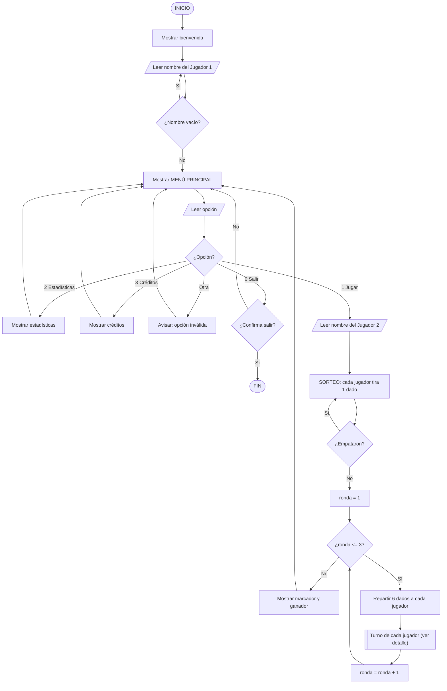
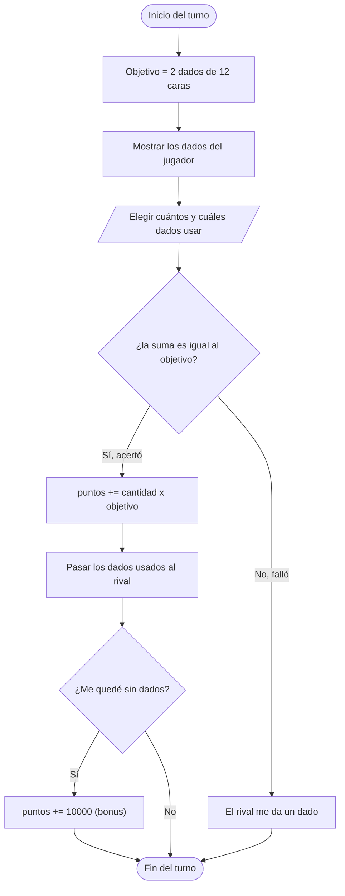

# Enfrendados

Un juego de dados para dos jugadores, hecho en C++ para la consola.

El nombre es un juego de palabras: dos jugadores **enfrentados**... con **dados**. De ahí "Enfren-dados".

Es un trabajo grupal de la materia **Programación I** (UTN FRGP, 2025 – 1.º cuatrimestre), pensado como práctica de los temas de la cursada: arreglos, funciones, condicionales, bucles y organización del código en módulos.

---

## De qué se trata

En cada turno el juego te da un **número objetivo** (sale de tirar dos dados de 12 caras) y vos tenés que elegir un subconjunto de tus dados cuya **suma dé exactamente ese número**. Si acertás, sumás puntos y te sacás dados de encima si errás, el rival te pasa uno de los suyos. La partida son 3 rondas, y al final gana el que más puntos juntó.

### Reglas

- Juegan **2 jugadores** por turnos.
- Al empezar, un **sorteo** (cada uno tira un dado) decide quién arranca.
- Cada ronda, ambos reciben **6 dados** de 6 caras.
- En tu turno se sortea un **objetivo** (2 dados de 12 caras) y elegís cuántos y cuáles de tus dados usar.
  - **Si la suma da el objetivo:** ganás `cantidad de dados × objetivo` puntos, esos dados pasan al rival, y si te quedás sin dados hay un **bonus** grande.
  - **Si no da:** el rival te entrega uno de sus dados.
- Se juegan **3 rondas** y al final se muestra el marcador y el ganador (o empate).

---

## Cómo funciona (menú)

Al iniciar, el programa pide el nombre del Jugador 1 y muestra el menú principal:

1. **Jugar con 2 jugadores** – pide el nombre del Jugador 2 y arranca la partida.
2. **Estadísticas** – muestra el marcador de la última partida y quién va ganando.
3. **Créditos** – el equipo y cómo repartimos el trabajo.
0. **Salir** – con confirmación.

---

## Estructura del proyecto

El código está separado en dos módulos, cada uno con su header y su implementación:

```
Enfrendados/
├── main.cpp                          # Punto de entrada: arranca el juego y maneja el menu
├── header/
│   ├── funcionesInterfazUsuario.h    # Declaraciones de la parte visual / entrada-salida
│   └── funcionesLogicaJuego.h        # Declaraciones de la logica del juego
├── src/
│   ├── funcionesInterfazUsuario.cpp  # Menu, banners, creditos, estadisticas, pausas
│   └── funcionesLogicaJuego.cpp      # Dados, seleccion, puntajes, rondas y turnos
├── rlutil.h                          # Libreria externa (de terceros) para limpiar la consola
└── README.md
```

- **Interfaz de usuario:** todo lo que el jugador ve y escribe (menú, carteles, validaciones de entrada).
- **Lógica del juego:** las reglas (tirar dados, elegir, calcular puntajes, manejar los turnos).
- **rlutil.h** no es nuestro: es una librería de terceros (rlutil, de Tapio Vierros) que usamos solo para limpiar la pantalla entre secciones.

---

## Cómo compilar y ejecutar

Con **g++** (Linux, macOS o Windows con MinGW), parado en la carpeta del proyecto:

```bash
g++ main.cpp src/funcionesLogicaJuego.cpp src/funcionesInterfazUsuario.cpp -Iheader -o enfrendados
```

Y para ejecutarlo:

```bash
./enfrendados
```

No depende de comandos de un sistema operativo puntual, así que corre igual en cualquier consola.

---

## Diagrama de flujo

### Flujo principal



### Detalle de un turno



---

## Conceptos de la cursada que usamos

- Variables, tipos y **arreglos** (los dados y los puntajes se manejan con arreglos).
- **Funciones** con parámetros por valor y **por referencia**.
- **Condicionales** (`if` / `else` / `switch`) y **bucles** (`for`, `while`, `do-while`).
- **Booleanos** para el control del flujo (por ejemplo, cuándo salir del menú).
- **Modularización**: separar el código en headers e implementaciones.

---

## Equipo 12

| Integrante                | Legajo |
|---------------------------|--------|
| Fernandez, Augusto Martin | 32592  |
| Canela, Gabriela Maribel  | 33157  |
| Gimenez, Lautaro Nehuen   | 32432  |
| Lavini, Ignacio German    | 31988  |

---

Proyecto académico — Programación I, UTN FRGP, 2025.
